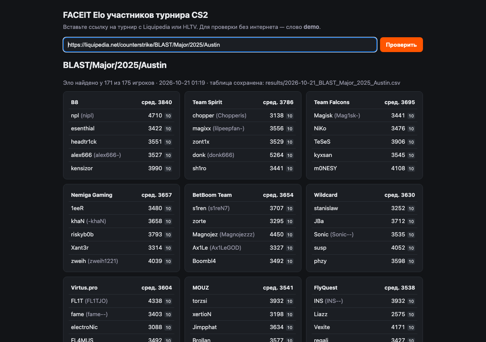

cs-turnir — приложение: ссылка на турнир CS2 (Liquipedia или HLTV) → таблица команд и игроков с текущим FACEIT Elo и средним по команде.

## Скачать (macOS)
Готовая сборка: [GitHub Releases → cs-turnir-macos-v0.2.0.zip](https://github.com/ritok1337/cs-turnir/releases/latest). Распакуйте архив; нужен Python 3 (на Mac он ставится вместе с инструментами разработчика Xcode).
Программа не подписана Apple, поэтому при первом запуске: правый щелчок по «Запустить CS Elo.app» → «Открыть» → «Открыть» (или Системные настройки → Конфиденциальность и безопасность → «Всё равно открыть»).

## Как запустить
1. Дважды щёлкнуть «Запустить CS Elo.app» в этой папке — откроется страница в браузере.
2. Вставить ссылку на турнир и нажать «Проверить» (1–3 минуты). Слово `demo` — тестовые данные без интернета.
3. Кнопка «Выключить приложение» внизу страницы останавливает его.

Каждая таблица также сохраняется в папку `results/` (CSV, открывается в Numbers/Excel).

## Пример работы (проверено 21.10.2026)
Ссылка: https://liquipedia.net/counterstrike/BLAST/Major/2025/Austin — эло найдено у 171 из 175 игроков, проверка заняла ~4 минуты.



- Полный скриншот страницы: [docs/screenshot-austin-major.png](docs/screenshot-austin-major.png)
- Таблица текстом: [docs/example-austin-major-2025.txt](docs/example-austin-major-2025.txt)
- Таблица CSV: [docs/example-austin-major-2025.csv](docs/example-austin-major-2025.csv)

Запуск без значка (терминал, любая ОС с Python 3.9+ и curl):
```
python3 app/elo_app.py demo                                   # тестовые данные
python3 app/elo_app.py https://liquipedia.net/counterstrike/... # таблица в терминале
python3 app/elo_app.py                                        # веб-страница http://localhost:8765
```

## Как это работает
- Составы берутся со страницы турнира на Liquipedia (тренеры не считаются).
- FACEIT-профиль игрока — из его страницы на Liquipedia (поле faceitdb/faceit), эло — с faceit.com.
- HLTV не пускает программы, поэтому по ссылке HLTV приложение само находит этот турнир на Liquipedia.
- Если у игрока нет страницы или на ней не указан FACEIT, приложение ищет его на FACEIT само: по точному нику и среди друзей тиммейтов (ник может отличаться: 1↔i, 0↔o, приставки).
- Найденный так игрок засчитывается, только если на FACEIT он связан с уже найденными тиммейтами. Если связи нет — эло показано с пометкой «~» и в среднее по команде не входит (чтобы не подставить однофамильца).
- Ник в таблице — ссылка на профиль FACEIT, можно проверить глазами.

## Файлы
- `app/elo_app.py` — весь код (Python 3.9+, без дополнительных библиотек)
- `app/demo_tournament.json` — тестовые данные
- `Запустить CS Elo.app` — значок для запуска
- `results/` — сохранённые таблицы
- `docs/` — скриншоты и пример результата
